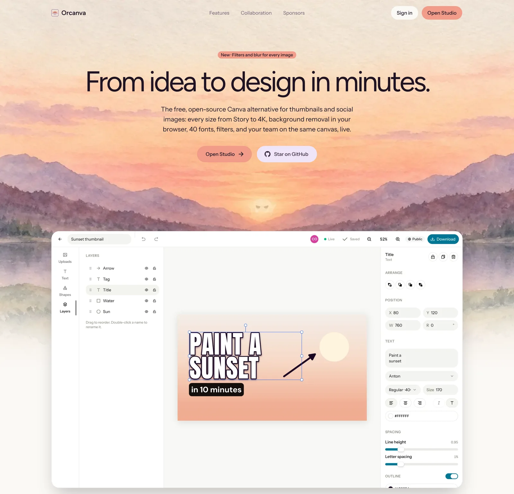

  <a href="https://www.orcanva.app">
    <picture>
      <source media="(prefers-color-scheme: dark)" srcset="https://shieldcn.dev/header/glow.svg?title=Orcanva&subtitle=The+free%2C+open-source+Canva+alternative+for+thumbnails+and+social+images&logo=https%3A%2F%2Fwww.orcanva.app%2Fapple-icon.png&theme=orange&size=wide&mode=dark" />
      
    </picture>
  </a>

  
  
  

  
  
  
  
  
  
  
  

<a href="https://www.orcanva.app">
  <picture>
    <source media="(prefers-color-scheme: dark)" srcset=".github/assets/readme-hero-dark.webp" />
    
  </picture>
</a>

Orcanva is a free, open-source Canva alternative for YouTube thumbnails and social images. With it you can:

- Design at any size, from a YouTube thumbnail to an Instagram post, a Story or 4K, from a blank page or a template
- Add text in 40 fonts, photos, shapes, and thousands of icons, emoji and stickers
- Remove backgrounds, erase objects and upscale photos, right in your browser
- Design together live, with comments and version history
- Download as PNG, JPG, WebP or PDF

Try it at [orcanva.app](https://www.orcanva.app). To run it yourself, see [DEVELOPMENT.md](DEVELOPMENT.md).

## License

[MIT](LICENSE)
